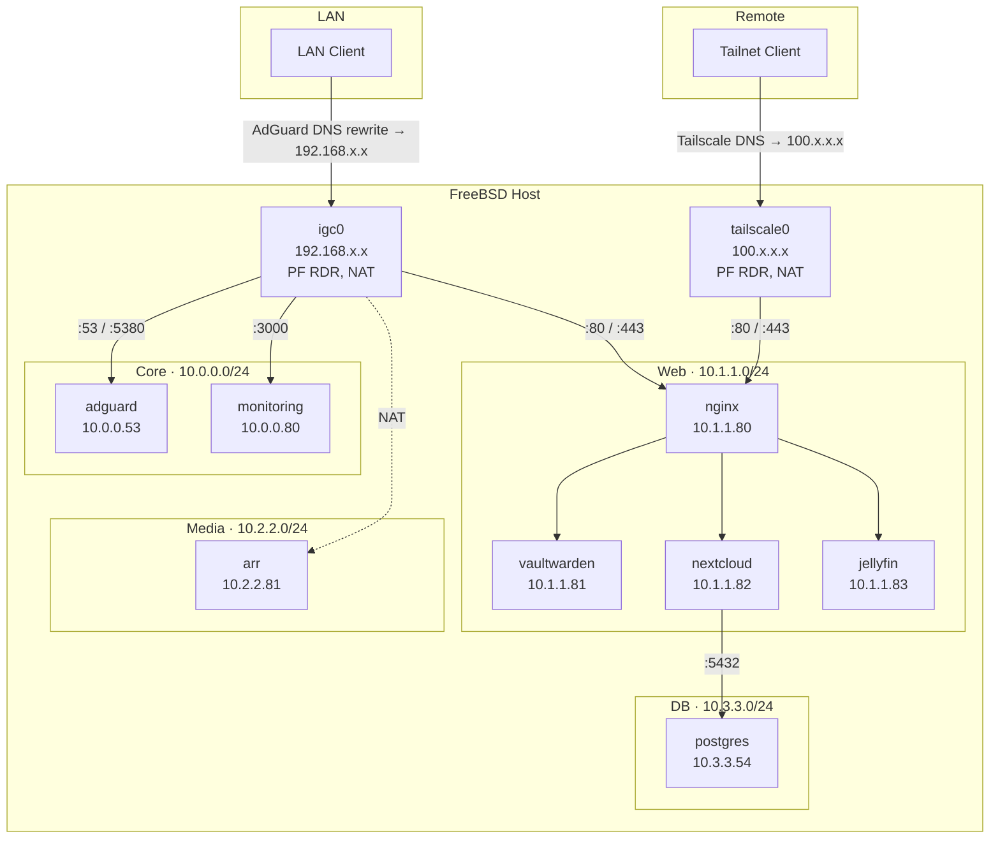

# Home Lab

A self-hosted infrastructure running on FreeBSD, using Bastille jails
for service isolation, PF for stateful firewalling, ZFS for storage, and Tailscale for
zero-config remote access.


## Why this exists

- NextCloud: Free storage for backups at home instead of relying on expensive providers.
- Adguard: With smart home devices becoming more and more common, to block out all tracking.
- Jellyfin: To watch my personal media on TV and multiple home devices without copying them around.
- Vaultwarden: To safely store my passwords on my hardware involving no one in between.
- Experimenting: To try out new things !

## Architecture



Each Bastille jail class runs on its own loopback interface (`lo1`–`lo4`), each mapped to a
dedicated `/24`. Blast radius is contained by subnet: a compromised media-stack jail has no
network path to the database subnet unless PF explicitly allows it.

## Services

| Jail          | Subnet                | IP           | Role                              |
|---------------|------------------------|--------------|-------------------------------------|
| `adguard`     | BastilleCore (10.0.0.0/24) | 10.0.0.53    | DNS / ad & tracker filtering      |
| `monitoring`  | BastilleCore               | 10.0.0.80    | Prometheus and Grafana for monitoring the system |
| `nginx`       | BastilleWeb (10.1.1.0/24)  | 10.1.1.80    | Reverse proxy, TLS termination    |
| `vaultwarden` | BastilleWeb                | 10.1.1.81    | Bitwarden-compatible password mgr |
| `nextcloud`   | BastilleWeb                | 10.1.1.82    | File sync / self-hosted cloud     |
| `jellyfin`    | BastilleWeb                | 10.1.1.83    | Media server                      |
| `arr`         | BastilleMedia (10.2.2.0/24)| 10.2.2.81    | Sonarr, Radarr, Transmission      |
| `postgres`    | BastilleDB (10.3.3.0/24)   | 10.3.3.54    | Shared PostgreSQL 16 backend      |

## Storage

Two ZFS pools with distinct roles:

| Pool | Device | Purpose |
|------|--------|---------|
| `zroot` | SSD | Fast random I/O — downloads in progress, Nextcloud upload staging |
| `data` | HDD (SMR) | High-capacity bulk storage — settled media and files |

### Dataset layout and jail isolation

Each jail is exposed only to its own dataset via `nullfs` mounts. The jail sees a normal
local directory; it has no path to any other jail's data.

| Host ZFS dataset | Mounted inside jail at | Jail |
|---|---|---|
| `zroot/data/nextcloud` | `/data/appdata_ocvvl2x7an0r` | `nextcloud` |
| `data/nextcloud` | `/data` | `nextcloud` |
| `zroot/data/arr` | `/downloads` | `arr` |
| `data/media` | `/data` | `arr`, `jellyfin` |
| `data/vaultwarden` | `/data` | `vaultwarden` |

### Media pipeline (SSD staging → HDD)

SMR drives handle large sequential writes fine but collapse under random writes —
an active torrent generates hundreds of small random writes that trigger read-modify-rewrite
cycles across entire SMR bands (~256 MB), stalling throughput. The pipeline avoids this:

```
Transmission  →  downloads to zroot/data/arr (SSD)  ← absorbs random writes
     │
     │  download complete
     ▼
Sonarr / Radarr  →  moves file into data/media (HDD)  ← one clean sequential write
     │
     ▼
Jellyfin  →  reads data/media (HDD)  ← sequential streaming reads
```

The HDD only ever sees one large, linear write per completed file, which is exactly
the access pattern SMR is optimised for.

### Nextcloud I/O split

Nextcloud has two distinct I/O profiles handled by separate datasets:

| Dataset | Content | I/O pattern | Pool |
|---|---|---|---|
| `zroot/data/nextcloud` | Upload chunks, temp files, cache | Random writes | SSD |
| `data/nextcloud` | Settled user files (photos, docs) | Sequential reads | HDD |

A device syncing photos generates many small random writes. Landing those on SSD avoids
the same SMR penalty as torrents. Once committed, the files sit on HDD and are read back
sequentially.

## Design decisions

- **One subnet per trust tier, not per host.** Core (DNS), Web (user-facing apps), Media, and
  DB each get their own `/24`. This makes PF policy readable as "tier X can talk to tier Y for
  reason Z" instead of a flat list of host exceptions.
- **Default-deny PF policy.** Every jail interface starts closed; rules are additive and
  scoped to specific ports/protocols rather than broad subnet-to-subnet allows.
- **HTTPS without owning a domain.** Two different client populations
  resolve the same domain name to two different addresses (Tailscale DNS → tailscale0,
  AdGuard DNS rewrite → the LAN-facing host IP directly). By doing this we can let Tailscale get 
  a signed SSL certificate for HTTPS and use the same locally without having to self-sign or 
  buy a domain.
- **Path-based Routing in Nginx:** Since I am relying on tailscale for the certificate, I cannot
  use subdomains as tailscale does not provide a wildcard certificate. Hence I use a path
  based routing to expose different services on /service_name.

## Stack

`FreeBSD 15.0-RELEASE` · `Bastille` (jails) · `PF` (firewall) · `ZFS` · `Tailscale` ·
`nginx` · `PostgreSQL 16` · `Nextcloud` · `Vaultwarden` · `Jellyfin` · `Sonarr` /
`Radarr` / `Transmission` · `AdGuard Home`

## License

MIT
